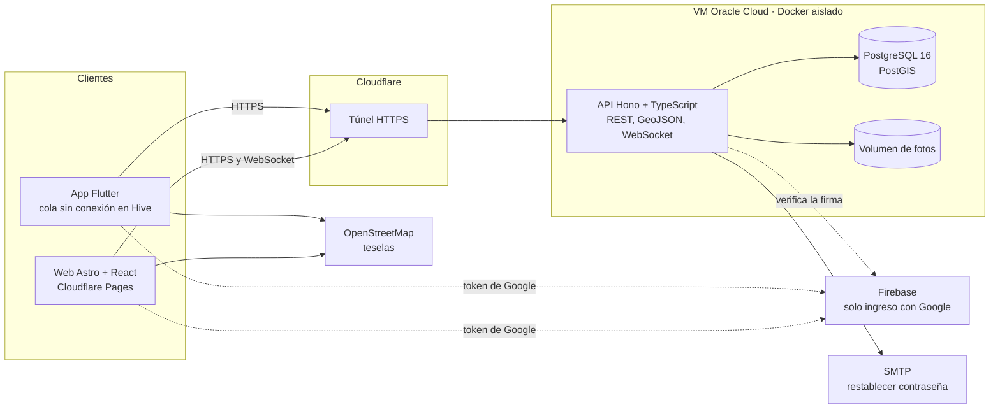
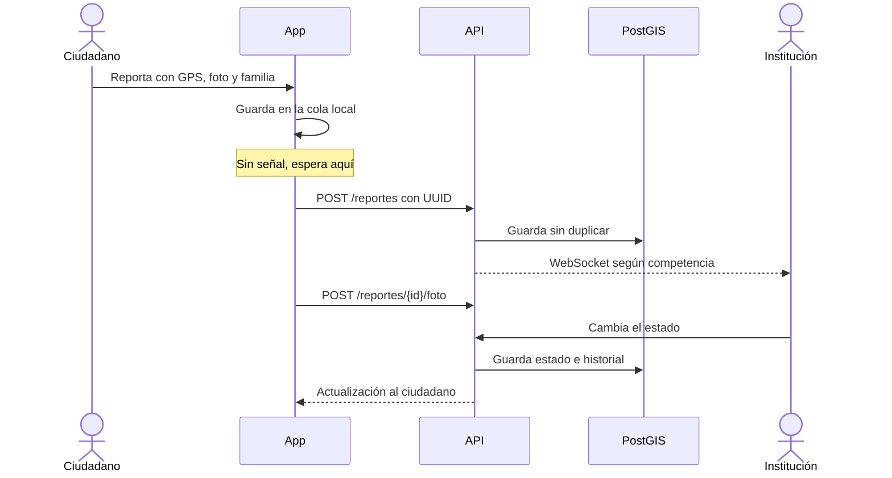

# Arquitectura

## Flujo de un reporte

## Capas

| Componente | Capas | Regla |
|---|---|---|
| API (`apps/api`) | `dominio`, `aplicacion`, `infraestructura`, `http` | El dominio no conoce HTTP ni la base. |
| App (`mobile`) | `presentation`, `domain`, `data` | La presentación depende del dominio. |
| Web (`apps/web`) | Páginas Astro con islas React | Un cliente único habla con la API. |

## Por qué estas tecnologías

| Elección | Motivo |
|---|---|
| PostGIS | Distancias reales, polígonos e intersecciones en la base. |
| Flutter con Hive | Una sola app con almacenamiento local para operar sin señal. |
| Hono en Node 22 | API liviana con WebSocket y validación con zod. |
| Astro con islas React | Páginas rápidas y JavaScript solo donde hay interacción. |
| OpenStreetMap con Leaflet | Datos abiertos y sin costo de licencia. |
| Docker Compose | El mismo entorno en local y en la VM, aislado de otros servicios. |

Los permisos están en `docs/ROLES.md` y el despliegue en `docs/DESPLIEGUE.md`.
