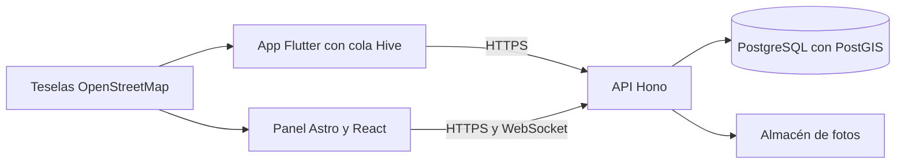

# Documentación técnica

Esmeraldas Resiliente es una plataforma georreferenciada para reportar emergencias y coordinar la respuesta ante los efectos del fenómeno El Niño en Esmeraldas.

Este documento resume la solución y enlaza el detalle de cada parte.

## Solución

| Pieza | Para quién | Qué hace |
| --- | --- | --- |
| App móvil Android | Ciudadanía e instituciones | Reporte con GPS y foto, cola sin conexión, seguimiento, alertas y albergue más cercano con cupo. |
| Panel web | ECU 911, Bomberos, Policía, administración | Mapa operativo, reportes, despacho, alertas por sector, vías, albergues, asistencia y estadísticas. |
| API | Web y app | Autenticación, reglas por rol, consultas espaciales, fotos y eventos en tiempo real. |
| Base de datos | API | Geometrías y datos operativos en PostGIS. |

Producción:

- Web: https://esmeraldas-resiliente.pages.dev
- API: https://api-esmeraldas.cifralabapp.com
- App Android: https://github.com/Adrianguanoluisaloza/Esmeraldas-resileinte/releases/download/app-movil/esmeraldas-resiliente.apk

Los datos de la semilla son simulados. La interfaz distingue siempre reporte ciudadano, dato simulado y alerta oficial. La plataforma no reemplaza al ECU 911.

## Tecnologías y justificación

| Componente | Elección | Por qué |
| --- | --- | --- |
| App móvil | Flutter, Clean Architecture, Hive | Un solo código, y cola local para operar sin conexión. |
| Web | Astro con islas React | HTML estático rápido, y React solo donde hay interacción. |
| Mapas | Leaflet, flutter_map, OpenStreetMap | Datos abiertos, con atribución visible y política de teselas respetada. |
| API | Hono, TypeScript, Node 22, zod | Ligera, tipada, con validación en cada entrada. |
| Tiempo real | WebSocket | Los cambios llegan al panel sin recargar. |
| Datos | PostgreSQL 16 y PostGIS, SRID 4326 | Consultas de distancia y sector sobre geometrías reales. |
| Seguridad | JWT propio, contraseñas en nuestro backend | Control propio de sesiones y roles. Firebase se usa solo para iniciar sesión con Google. |
| Infraestructura | Docker en Oracle Cloud, Cloudflare Pages y Tunnel | Contenedores aislados, HTTPS y sin puertos abiertos para la API. |

Justificación ampliada: [ARQUITECTURA.md](ARQUITECTURA.md) y [arquitectura/decision-mapas-hive-postgis.md](arquitectura/decision-mapas-hive-postgis.md).

## Arquitectura

La API sigue Clean Architecture: dominio, aplicación, infraestructura y HTTP. Las dependencias apuntan hacia el dominio. El repositorio tiene dos implementaciones: PostgreSQL para producción y memoria (`ALMACEN=memoria`) para desarrollo y pruebas.

Diagramas completos y flujo de un reporte: [ARQUITECTURA.md](ARQUITECTURA.md).

## Modelo de datos

Tablas: `usuarios`, `restablecimientos`, `zonas_riesgo`, `vias`, `puntos_servicio`, `reportes`, `reportes_historial`, `alertas`, `entregas` e `inventario`.

- Esquema: `database/01_schema_postgis.sql`.
- Semilla del escenario Jueves 06:00: `database/02_seed_escenario_06am.sql`.
- Diagrama entidad-relación: [MODELO_DATOS.md](MODELO_DATOS.md).

## Servicios de integración

El contrato es `contrato/openapi.yaml`. Ningún cliente usa campos que no estén ahí.

| Grupo | Rutas |
| --- | --- |
| Acceso | `/auth/registro`, `/auth/login`, `/auth/firebase`, `/auth/recuperar`, `/auth/restablecer` |
| Reportes | `/reportes`, `/reportes/{id}`, `/reportes/{id}/estado`, `/reportes/{id}/foto`, `/fotos/{nombre}` |
| Territorio | `/zonas`, `/vias`, `/vias/{id}/estado`, `/puntos-servicio`, `/puntos-servicio/cercanos`, `/puntos-servicio/{id}/ocupacion` |
| Alertas | `/alertas`, `/alertas/{id}/cerrar` |
| Asistencia | `/asistencia/pendientes`, `/asistencia/entregas`, `/asistencia/inventario` |
| Análisis | `/estadisticas`, `/estadisticas/recurrencia` |
| Administración | `/usuarios`, `/usuarios/{id}/rol` |
| Estado | `/salud` |

`/reportes/{id}/clasificar` está reservado para la clasificación con IA. Responde 501 porque esa función no está implementada.

## Roles

| Rol | Alcance |
| --- | --- |
| Ciudadano | Crea reportes, sigue los suyos y consulta albergues. |
| ECU 911 | Ve todo el territorio, despacha y emite alertas. |
| Bomberos | Inundación, deslizamiento, personas atrapadas y daño de vivienda. |
| Policía | Vías bloqueadas y personas atrapadas. Actualiza el estado de las vías. |
| Administrador | Gestiona usuarios y roles. |

La competencia se valida en el servidor. Matriz completa: [ROLES.md](ROLES.md). Los roles y cuentas son de demostración y no implican convenios con esas instituciones.

## Funcionamiento sin conexión

La app guarda el reporte con su ubicación y foto en Hive y lo envía al volver la red. Sin ninguna red el dato no puede salir del teléfono. La pasarela SMS y el enlace satelital están en [PROPUESTAS.md](PROPUESTAS.md), junto con rutas por la red vial, censo de familias e IA. El envío SMS está desactivado y nunca apunta al 911 real.

## Despliegue

- Base y API: `docker compose up -d --build` en la VM de Oracle Cloud, con contenedores propios y límites de CPU.
- Exposición de la API: Cloudflare Tunnel.
- Web: compilación de Astro con `PUBLIC_API_URL` y publicación en Cloudflare Pages.
- App: compilación firmada en GitHub Actions (`.github/workflows/build-apk.yml`).

Los secretos viven en variables de entorno, fuera del repositorio. Pasos completos: [DESPLIEGUE.md](DESPLIEGUE.md). Seguridad: [SEGURIDAD.md](SEGURIDAD.md).

## Calidad y resultados

| Prueba | Resultado |
| --- | --- |
| API (`npm run ci`) | 54 pruebas en verde |
| Flutter | 14 pruebas en verde |
| Auditoría de producción | 24 de 24 comprobaciones: rutas, roles, capas, PostGIS, fotos, restablecimiento, WebSocket, teselas y APK |
| Carga, lecturas | Unas 1490 solicitudes por segundo con 1000 conexiones, 0 errores |
| Carga, lecturas con token | Unas 850 solicitudes por segundo, 0 errores |
| Carga, escrituras | Unas 800 solicitudes por segundo, 0 errores |

La carga se midió con límite de 1.5 CPU por contenedor.

## Límites conocidos

- La IA predictiva es una propuesta: requiere datos históricos reales.
- Sin ninguna red no hay envío, solo cola local.
- Las cifras de la semilla son simuladas.
- La app se distribuye como APK de Android. No está publicada en tiendas.

## Manual de usuario

[MANUAL_USUARIO.md](MANUAL_USUARIO.md).
