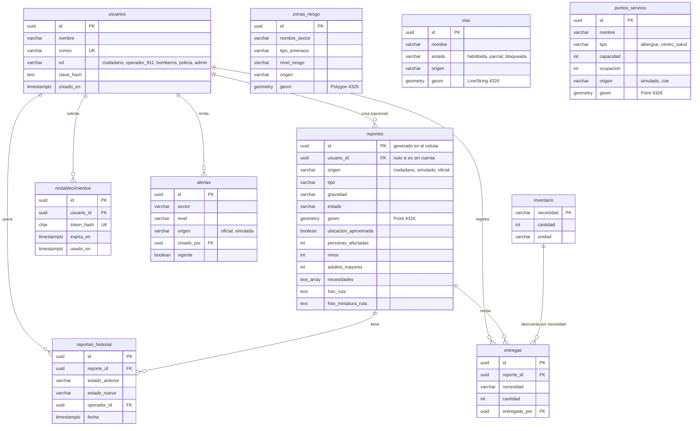

# Modelo de datos

PostgreSQL 16 + PostGIS. Todas las geometrías usan SRID 4326 (WGS84) y tienen índice GIST.
Fuente exacta: `database/01_schema_postgis.sql`.

## Consultas geográficas

| Uso | Función |
|---|---|
| Sector de un reporte | Punto dentro de `zonas_riesgo` |
| Albergue más cercano con cupo | `ST_Distance` sobre `geography` |
| Paso bloqueado hacia un albergue | `ST_Intersects` con `vias` bloqueadas |
| Capas del mapa | GeoJSON generado desde PostGIS |

## Integridad y protección de datos

- La entrega y el descuento de inventario ocurren en la misma transacción.
- `reportes_historial` y `entregas` son de solo inserción: un trigger bloquea cambios y borrados.
- La API entra con `resiliente_app`, sin permiso de borrar ni de cambiar el esquema.
- Las coordenadas fuera de la provincia se rechazan en la base y en la API.
- Las contraseñas y los enlaces de restablecimiento se guardan solo como hash.
